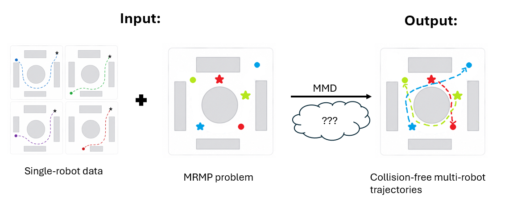
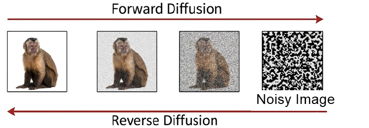
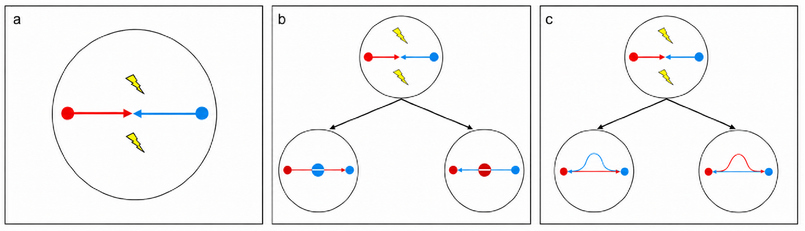
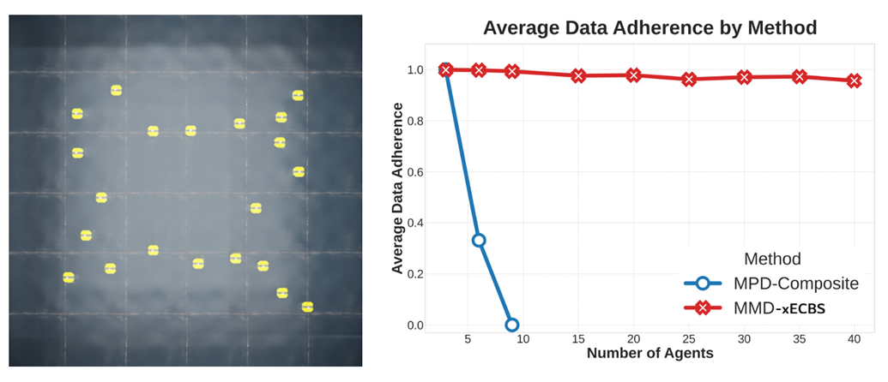
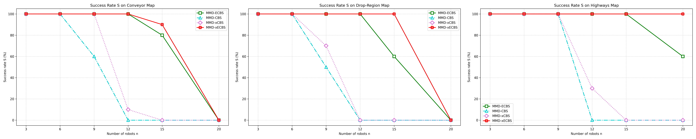
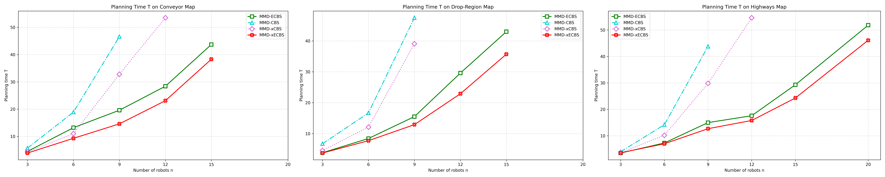

## Motivation
Imagine a busy intersection without traffic lights. Every vehicle knows where it wants to go, but without coordination, even simple movements can lead to congestion or collisions. A similar problem arises in multi-robot systems, where several robots share the same space and must avoid collisions while reaching their goals efficiently. The challenge grows with the size of the team because every additional robot introduces new interactions that the others must account for.

This challenge is not just theoretical. As robots are increasingly deployed in applications such as warehouse automation, autonomous driving, and drone coordination, solving this coordination problem becomes critical for safety, efficiency, and scalability. Just as the intersection requires more than individual drivers acting independently, multi-robot systems need a strategy that coordinates the team as a whole.

This post examines a recent approach to this problem: Multi-robot Multi-model Planning Diffusion (MMD) <a class="citation" href="#ref-1">[1]</a>. We begin by introducing the multi-robot motion-planning problem and the main families of approaches used to address it. We then build up MMD step by step, showing how it combines diffusion-based trajectory generation with MAPF-inspired conflict resolution, before turning to the experimental results and their practical implications.

## Table of contents

<nav class="toc-latex toc-latex--timeline" aria-label="Table of contents">
      <ol>
        <li><a href="#motivation">Motivation</a></li>
        <li>
          <a href="#multi-robot-motion-planning">Multi-robot motion planning</a>
          <ol>
            <li><a href="#categorizing-mrmp-approaches">Categorizing MRMP approaches</a></li>
          </ol>
        </li>
        <li>
          <a href="#multi-robot-multi-model-planning-diffusion-mmd">Multi-Robot Multi-Model Planning Diffusion (MMD)</a>
          <ol>
            <li><a href="#diffusion-models">Diffusion models</a></li>
            <li><a href="#guiding-diffusion-models">Guiding diffusion models</a></li>
            <li><a href="#from-guided-trajectory-generation-to-multi-robot-planning">From guided trajectory generation to multi-robot planning</a></li>
            <li><a href="#mmd-pp">MMD-PP</a></li>
            <li><a href="#mmd-cbs">MMD-CBS</a></li>
            <li><a href="#mmd-ecbs">MMD-ECBS</a></li>
            <li><a href="#mmd-xcbs-and-mmd-xecbs">MMD-xCBS and MMD-xECBS</a></li>
          </ol>
        </li>
        <li><a href="#bringing-it-all-together">Bringing it all together</a></li>
        <li>
          <a href="#experiments">Experiments</a>
          <ol>
            <li><a href="#single-robot-data-vs-direct-multi-robot-learning">Single-Robot Data vs. Direct Multi-Robot Learning</a></li>
            <li><a href="#comparing-cbs-based-methods">Comparing CBS-based methods</a></li>
            <li><a href="#comparing-mmd-xecbs-to-mmd-pp">Comparing MMD-xECBS to MMD-PP</a></li>
            <li><a href="#does-it-work-in-practice">Does it work in practice?</a></li>
          </ol>
        </li>
        <li><a href="#conclusion">Conclusion</a></li>
        <li><a href="#references">References</a></li>
      </ol>
    </nav>

## Multi-robot motion planning
To design such a coordination strategy, we first need to formalize the problem. Multi-robot motion planning (MRMP) asks: given a set of robots with start and goal configurations, how can we find a collision-free trajectory for each robot over time while optimizing an objective function \\(J\\)? This objective can encode a variety of goals, such as trajectory smoothness, energy efficiency, or application-specific task objectives.

<figure class="blog-figure">
  
  <figcaption>MRMP in a weave scenario with multiple coordinated robots. Source: Shaoul et al. <a href="https://multi-robot-diffusion.github.io/" target="_blank" rel="noopener">MMD project website</a>.</figcaption>
</figure>

This formulation also makes clear why MRMP is computationally demanding. The general, continuous version of the problem is PSPACE-hard <a class="citation" href="#ref-2">[2]</a>, and even the more restricted case where robots move along paths on a graph remains NP-complete to solve optimally for common objectives <a class="citation" href="#ref-3">[3]</a>. Different planning families therefore make different trade-offs between solution quality, computational cost, and scalability.

## Categorizing MRMP approaches
Approaches to MRMP can be categorized by the type of planner they use <a class="citation" href="#ref-4">[4]</a>. *Search-based* motion planning uses a discrete representation of the problem and searches over it for paths; depending on the algorithm, these searches can guarantee finding a solution if one exists (completeness), an optimal solution (optimality), or both. *Sampling-based* motion planning instead avoids exploring the full configuration space and reasons over a much smaller set of randomly sampled configurations. Finally, *ML-guided* or *ML-based* approaches use learned models, either to support a conventional planner (e.g., by learning a cost map or heuristic from demonstration data) or to directly predict trajectories.

Learning behaviors directly from data has become a common approach in modern robotics more broadly. Given a large collection of example trajectories, a model can learn to generate new trajectories that exhibit similar behavior — for instance, moving the way a human operator would — without anyone having to explicitly program that behavior. The alternative, defining such motion patterns by hand, is difficult whenever a behavior is easier to demonstrate than to describe with explicit rules. Although the approach works well for individual robots, extending it to a team is difficult: more robots create more interactions, and representing those interactions requires much larger datasets. Collecting suitable multi-robot training data therefore becomes expensive and limits the scalability of many learning-based approaches.

This distinction by planner type is only one part of the picture. MRMP algorithms can also be distinguished by how they handle interactions between robots <a class="citation" href="#ref-1">[1]</a>. Decoupled algorithms plan motions for robots one after another, treating already-planned robots as moving obstacles for the rest. Coupled algorithms instead treat the problem as a single system, planning jointly over the composite configuration space of all robots. Hybrid algorithms sit in between: they split MRMP into a high level, where conflicts between robots are resolved, and a low level, where motion for each robot is planned independently — typically using single-robot planners such as A\*.

Taken together, these two classifications place MMD among hybrid, ML-based algorithms. It uses a high-level search to resolve conflicts and diffusion models to generate the individual trajectories. At the same time, it sidesteps the data-scaling problem by learning exclusively from single-robot trajectory data while still planning collision-free motions for multiple robots.

## Multi-Robot Multi-Model Planning Diffusion (MMD)
At first glance, this may seem surprising: if the model never observes interactions between multiple robots during training, how can it later generate collision-free trajectories in a multi-robot setting? The answer lies in separating trajectory generation from conflict resolution. We begin with the diffusion models that provide the former.

<figure class="blog-figure">
  
  <figcaption>Figure 1: From single-robot data to coordinated multi-robot planning with MMD.</figcaption>
</figure>

### Diffusion models
Diffusion models are often used for generating images from noise. They achieve this by incrementally removing noise over many small denoising steps until a clean image is obtained. Surprisingly, teaching a model to perform many simple denoising steps is often much easier than teaching it how to generate a realistic image in a single step, as each step only has to make a small, local correction instead of solving the whole problem at once.

<figure class="blog-figure">
  
  <figcaption>Figure 2: Forward diffusion adds noise; reverse diffusion learns to remove it.</figcaption>
</figure>

The same idea transfers naturally from images to robot trajectories. Rather than refining noisy pixels, a diffusion model starts with random noise in trajectory space and gradually turns it into trajectories that follow the patterns in the demonstrated data. We only need the basic intuition here; for a more detailed introduction to diffusion models, see <a class="citation" href="#ref-5">[5]</a>.

<figure class="blog-figure">
  
  <figcaption>Figure 3: The same diffusion principle applied to trajectories.</figcaption>
</figure>

Here, \\(i\\) identifies a robot, while \\(K\\) denotes the initial and noisiest step of the diffusion process. Starting from this noisy state, the trajectory for robot \\(i\\) is iteratively denoised until step \\(0\\), producing the final trajectory.

Diffusion models commonly use stochastic rather than deterministic sampling: the trajectory at the next denoising step is drawn from a normal distribution. This randomness allows the model to represent multiple plausible motions instead of always producing the same trajectory:

$$
{}^{k-1}\tau^i \sim \mathcal{N}\left(\mu_{k-1}^i, \beta_{k-1}\right)
$$

Here, \\(k\\) denotes the current diffusion step. The trajectory \\({}^{k-1}\tau^i\\) is sampled from a normal distribution whose mean \\(\mu_{k-1}^i\\) is predicted by the diffusion model and whose variance \\(\beta_{k-1}\\) controls how much randomness is retained during the current denoising step. Early steps typically allow more variation, while later steps make smaller refinements to the trajectory.

Generating trajectories that resemble the training data is useful, but it is not yet motion planning. A planner must also satisfy task-specific objectives, such as reaching a goal, avoiding obstacles, or producing smooth motion. This is where guidance enters the picture.

### Guiding diffusion models
Diffusion models let us incorporate such objectives directly into the denoising process. Instead of only following the learned data distribution, we can additionally bias each denoising step using an objective function \\(J\\).

Adding this ***guidance*** term to the formula, we obtain:

$$
{}^{k-1}\tau^i \sim \mathcal{N}\left(
\mu_{k-1}^i +
\underbrace{\eta\beta_{k-1} \nabla_{\tau} J\left(\mu_{k-1}^i\right)}_{\text{Guidance}},
\beta_{k-1}
\right)
$$

The objective function \\(J\\) can be composed of multiple sub-objectives, each targeting a different goal, with weights \\(\lambda\\) controlling how strongly each one influences the generated trajectory. For example,

$$
J
= \lambda_{\mathrm{collision}} J_{\mathrm{collision}}
+ \lambda_{\mathrm{smooth}} J_{\mathrm{smooth}}
$$

encourages trajectories that both avoid collisions and remain smooth.

One particularly useful objective is the ***sphere constraint*** — implemented as a soft constraint rather than a hard constraint — which discourages a robot from entering a predefined spherical region. Concretely, it penalizes a robot whenever its distance to a fixed point \\(p\\) falls below a safety radius \\(r\\) (see <a class="citation" href="#ref-1">[1]</a> for the exact formulation). By placing such spheres around other robots, the sphere constraint can discourage collisions during trajectory generation.

At this point, we can generate data-adherent trajectories and steer them away from specific regions using the sphere constraint. It may therefore seem that planning is solved: why not place sphere constraints along the trajectories of all other robots and let the diffusion models do the rest?

The problem is that we still do not know ***where*** these constraints should be placed and ***when*** they should be applied. In a multi-robot scenario, collisions may occur at different locations and at different points in time. Finding an effective strategy for placing constraints therefore becomes a planning problem in its own right.

### From guided trajectory generation to multi-robot planning
MMD addresses this remaining planning problem by borrowing ideas from classical Multi-Agent Path Finding (MAPF) algorithms. In MAPF, the environment is represented as a discrete graph: robots occupy vertices and move between adjacent vertices in discrete time steps, with the goal of reaching their destinations without colliding. Extensive MAPF research has produced algorithms that can compute near-optimal solutions for hundreds of agents.

Although these algorithms were designed for a discrete setting, their conflict-resolution strategies transfer to the continuous trajectory-generation problem considered here. MMD adapts Prioritized Planning (PP), Conflict-Based Search (CBS), and several CBS extensions. Each provides a different answer to the question left open by guidance: where and when should collision-avoidance constraints be introduced?

### MMD-PP
The simplest MMD variant, MMD-PP, starts with Prioritized Planning. It assigns a fixed priority ordering to the robots and generates their trajectories sequentially.

Figure 4 illustrates this process. First, the highest-priority robot generates its trajectory independently. In the example, the red robot plans a trajectory from its start position to its goal without considering any other robots. Once this trajectory has been generated, it is treated as a dynamic obstacle for all remaining robots.

When planning the trajectory of the blue robot, MMD places sphere constraints along the already generated red trajectory. As a result, the diffusion model of the blue robot is guided away from the red path and generates an alternative trajectory that avoids a potential collision.

<figure class="blog-figure">
  
  <figcaption>Figure 4: Prioritized planning in MMD-PP.</figcaption>
</figure>

MMD-PP's main strength and weakness both follow from this fixed ordering. Planning each robot only once keeps the method computationally attractive, but the resulting solution is not guaranteed to be collision-free. Because sphere constraints are soft, a lower-priority robot may still violate a constraint introduced by an earlier robot. MMD-CBS addresses this limitation by replacing MMD-PP's proactive ordering with a reactive process that introduces constraints only after a collision has been observed.

### MMD-CBS
Rather than relying on an ordering of robots, MMD-CBS searches over a ***constraint tree***. Each node represents one planning scenario: a set of collision-avoidance constraints together with the trajectories generated under these constraints.

The root node represents the initial scenario, in which all robots generate their trajectories independently, without any additional collision-avoidance constraints. If these trajectories are already collision-free, the root node is a valid solution and planning is complete.

Otherwise, MMD-CBS repeatedly expands the constraint tree using the following steps:
1. Select the leaf node with the fewest remaining collisions.
2. Pick one collision and split the node into two child nodes, each constraining a different one of the two colliding robots.
3. In each child node, recompute the trajectory of the newly constrained robot under this additional constraint.

Figure 5 illustrates this process for a single collision between the red and blue robot. We start at the root node in Figure 5(a), the only node available at this point, where the two trajectories collide. Since this node contains only one collision, we pick that collision to resolve next. This creates the two child nodes shown in Figure 5(b): the left one constrains the blue robot at the conflict location and time, while the right one constrains the red robot instead. In each child node, only the newly constrained robot replans its trajectory, guided away from the collision by the added constraint, while the other robot's trajectory remains unchanged, as shown in Figure 5(c). Since replanning can introduce new collisions elsewhere, this process is repeated, expanding the tree further until a node with no remaining collisions is found.

<figure class="blog-figure">
  
  <figcaption>Figure 5: Conflict-Based Search resolves a collision by branching over constraints.</figcaption>
</figure>

Compared to MMD-PP, MMD-CBS introduces constraints only when they are actually needed. Rather than committing to a fixed priority ordering, it repeatedly analyzes the generated trajectories and resolves detected conflicts. This makes the method more robust and allows it to find collision-free solutions in cases where a fixed priority ordering may fail.

That flexibility comes at a cost: MMD-CBS must maintain and explore a constraint tree that becomes more expensive as the number of robots and conflicts increases. The authors therefore propose several extensions to improve efficiency, beginning with MMD-ECBS.

### MMD-ECBS
MMD-ECBS keeps MMD-CBS's conflict-specific constraints but adds a second type of constraint. These additional soft constraints encourage robots to stay away from the trajectories of other robots even before a collision has been detected. As a result, newly generated trajectories are not only guided away from previously observed conflict locations but are also biased away from potentially problematic regions of the workspace.

To distinguish between the two types of constraints, the collision-resolving constraints are referred to as ***strong constraints***, while the trajectory-avoidance constraints are called ***weak constraints***. Since avoiding a confirmed collision is more important than merely discouraging robots from getting close to one another, the weak constraints are assigned a smaller weight in the objective function.

MMD-ECBS changes which constraints guide replanning, but the replanning process itself remains unchanged: whenever a new constraint is added, the diffusion model still generates an entirely new trajectory.

### MMD-xCBS and MMD-xECBS
The final extensions, MMD-xCBS and MMD-xECBS, target this remaining source of computational cost. They retain the constraint strategies of CBS and ECBS, respectively, while reusing information from the previous solution.

Instead of restarting the diffusion process from pure random noise, these methods reuse the previously generated trajectory. To do so, they add noise for only a small number of diffusion steps and then continue the denoising process under the newly introduced constraints. Since the previous trajectory is already close to a feasible solution, this approach requires significantly less computation than generating an entirely new trajectory from scratch.

## Bringing it all together
Viewed as a progression, the variants modify two parts of the same framework: PP, CBS, and ECBS differ in when and where they introduce constraints, while the x-variants change how trajectories are regenerated after a constraint is added. Beneath these differences, the central idea remains the same. MMD learns how individual robots should move from single-robot trajectory data, uses MAPF-inspired planning strategies to resolve conflicts, and lets diffusion models generate trajectories that respect the resulting constraints while remaining faithful to the demonstrated motion patterns. In this way, MMD combines learning-based trajectory generation with search-based conflict resolution.

## Experiments
With the method established, we can now ask whether these design choices pay off in practice. The authors run a broad set of experiments; this post focuses on three questions: whether learning from single-robot data is sufficient compared with learning multi-robot coordination directly, which of MMD's CBS-based planning strategies performs best, and how the strongest of these variants compares with the simpler MMD-PP approach across different environments.

Four metrics appear repeatedly across these experiments: data adherence, success rate, trajectory length, and planning time. **Data adherence** measures how closely a generated trajectory matches the motion patterns in the training data. This matters because the appeal of learning from demonstrations is not merely to avoid collisions, but to capture realistic behavior without defining it by hand. **Success rate** measures how often a method produces a valid, collision-free solution. **Trajectory length** records how far a robot travels to reach its goal; shorter trajectories generally indicate fewer unnecessary detours. Finally, **planning time** captures the computational cost of generating a solution.

### Single-Robot Data vs. Direct Multi-Robot Learning
One of MMD's central ideas is to learn only from single-robot data and rely on a classical planner to handle multi-robot coordination rather than learning that coordination directly.

To evaluate whether this design choice is effective, the authors compare MMD-xECBS to MPD-Composite, a diffusion model trained to generate multi-robot trajectories directly.

As shown in Figure 6, both approaches achieve high data adherence for small robot teams. However, MPD-Composite deteriorates rapidly as the number of robots increases and eventually fails to generate valid solutions. MMD-xECBS, by contrast, maintains high data adherence and continues to generate collision-free trajectories for substantially larger teams. In these experiments, offloading coordination to a classical planner is therefore more effective than learning it directly from the available data.

<figure class="blog-figure">
  
  <figcaption>Figure 6: Single-robot data with MMD-xECBS compared to direct multi-robot learning.</figcaption>
</figure>

There is, however, an important caveat. MPD-Composite was not trained on real multi-robot demonstrations, since these are expensive to collect. Instead, it was trained on multi-robot datasets assembled from collision-free single-robot trajectories that were generated independently rather than planned together. The main results might therefore seem to show that diffusion models are fundamentally unable to handle multi-robot complexity. A closer reading, including the authors' discussion in the appendix, supports a narrower interpretation: learning from this kind of composed data is difficult.

### Comparing CBS-based methods
Beyond the choice to learn from single-robot data, MMD offers several planning strategies for resolving conflicts. We first look at which CBS-based variant performs best across three different environments.

<figure class="blog-figure">
  
  <figcaption>Figure 7: Evaluation maps used in the CBS-based method comparison.</figcaption>
</figure>

In terms of data adherence (Figure 8), there is little difference between the algorithms: all of them consistently score above 0.8, showing that they generate data-adherent trajectories regardless of the conflict-resolution strategy used.

<figure class="blog-figure blog-figure--data">
  

    
    
    
  

  <figcaption>Figure 8: Average data adherence by method.</figcaption>
</figure>

With data adherence remaining largely constant, success rate (Figure 9) becomes the more revealing distinction, especially since the pattern holds consistently across all three maps. MMD-CBS performs worst and starts to struggle once the number of robots reaches 9, while MMD-xCBS is only marginally better. MMD-ECBS clearly outperforms both, but is itself outperformed by MMD-xECBS. As the strongest method overall, MMD-xECBS still generates valid trajectories for up to 15 robots on the Conveyor and Drop-Region maps, and even up to 20 on the Highways map.

<figure class="blog-figure blog-figure--data">
  

    
    
    
  

  <figcaption>Figure 9: Success rate by method across maps.</figcaption>
</figure>

The success-rate ranking is also reflected in planning time (Figure 10). While the xCBS extension adds little in terms of effectiveness, MMD-ECBS substantially reduces planning time compared to MMD-CBS. Since planning time is one of the key bottlenecks for scaling MMD to larger robot teams, this improvement is particularly relevant in practice.

<figure class="blog-figure blog-figure--data">
  

    
    
    
  

  <figcaption>Figure 10: Average planning time by method.</figcaption>
</figure>

Planning time captures only one side of efficiency; average trajectory length on the Conveyor and Drop-Region maps adds an important nuance (Figure 11). MMD-xCBS produces trajectories that are almost twice as long as those of MMD-ECBS. So while ECBS improves trajectory length compared to plain CBS, adding the reuse mechanism in xCBS makes it worse again. The same reuse mechanism is also used in MMD-xECBS, but there it starts from ECBS's much lower baseline, so even with some of that length increase reintroduced, MMD-xECBS still ends up shorter than plain CBS or xCBS. One possible explanation is that reusing a previous trajectory instead of fully regenerating it from noise sacrifices some trajectory quality, while ECBS's constraint structure only partially offsets that trade-off.

<figure class="blog-figure blog-figure--data blog-figure--data-two-panels">
  

    
    
  

  <figcaption>Figure 11: Average trajectory length by method on the Conveyor and Drop-Region maps. The Highways map is excluded because it does not show a clear pattern.</figcaption>
</figure>

Taken together, MMD-xECBS appears to offer the best overall balance across these scenarios, although whether this generalizes to other settings remains open. Its trajectories are somewhat longer than those of MMD-ECBS, but I think the reduction in planning time is worth that trade-off: since scalability remains MMD's biggest limitation, a slightly suboptimal solution is still preferable to none at all.

### Comparing MMD-xECBS to MMD-PP
Now that we know MMD-xECBS performs best among the CBS-based variants, let's look at two comparisons between MMD-xECBS and MMD-PP across different scenarios.

In the Circle setup (Figure 12), the planning time of MMD-xECBS grows much more steeply than that of MMD-PP, which increases at a noticeably flatter rate. Because of this, MMD-xECBS is unable to generate valid trajectories for more than about 18 robots, while MMD-PP still succeeds for up to 30. However, MMD-PP does not reliably find valid solutions at every robot count: for some numbers of robots it succeeds, while for others, including some smaller ones, it fails. Its wider scaling range therefore comes at the cost of consistency.

<figure class="blog-figure">
  
  <figcaption>Figure 12: Circle setup and planning time comparison.</figcaption>
</figure>

The Weave setup (Figure 13) tells a different story: here, the planning times of both methods are very similar up to around 18 robots, at which point MMD-PP stops producing valid solutions altogether, while MMD-xECBS continues to scale up to around 28 robots.

<figure class="blog-figure">
  
  <figcaption>Figure 13: Weave setup and planning time comparison.</figcaption>
</figure>

Taken together, these two comparisons show that neither method is consistently better: which algorithm performs best depends heavily on the structure of the environment. This is a practical limitation, since one would need to know something about the environment in advance to choose the right algorithm.

### Does it work in practice?

The results so far show both the promise of MMD and the trade-offs behind it. This leads to the broader question of whether MMD is usable in practice.

My take: yes, *but* — with heavy emphasis on the "but".

The experiments clearly show that MMD scales to multiple robots while remaining data adherent. Across everything we covered, the strongest MMD variants reliably generated valid trajectories for at least 15 robots. The question is how far that gets us in practice. In a fully automated warehouse, for instance, operations are unlikely to stop at 15 robots; realistic deployments would need to handle numbers closer to the hundreds or thousands. 

Planning time is another concern. Looking at Figures 12 and 13, planning times in the range of 30 seconds are not unusual and would likely be too slow for applications that require frequent real-time replanning.

Moreover, as evaluated in the paper, MMD is primarily a pre-planning method: it computes trajectories up front and then has the robots execute them without reacting to environmental changes as they occur. This is a significant limitation in dynamic settings where, for example, humans may walk through the workspace. Robots need to react to unexpected changes in real time rather than simply follow a plan computed in advance.

That said, these limitations point to directions for future work rather than dead ends. Faster planning strategies or mechanisms for reacting to a changing environment could, in principle, be integrated into MMD's framework without giving up its core advantage of learning from single-robot data alone.

## Conclusion
MMD addresses one of the central challenges in multi-robot motion planning: how can multiple robots be coordinated without requiring large amounts of multi-robot training data? Its key idea is to combine diffusion-based trajectory generation with search-based conflict resolution. Rather than learning multi-robot interactions directly, MMD trains diffusion models on single-robot trajectories and then uses MAPF-inspired planning strategies to introduce constraints whenever conflicts occur. The experiments show that this is a promising combination. In the evaluated scenarios, the stronger MMD variants often generate valid trajectories for around 15 robots or more while preserving the motion patterns learned by the diffusion models. This is especially interesting because it suggests that multi-robot behavior does not necessarily have to be learned from multi-robot demonstrations directly.

At the same time, important limitations remain, including planning time, scalability, and dependence on the structure of the environment. The fact that the best-performing variant differs across scenarios further complicates practical use. MMD is therefore less a ready-to-use warehouse planner than a promising research direction. Its main contribution is showing that single-robot diffusion models can be reused for multi-robot planning without collecting expensive multi-robot datasets.

I think the next step for this line of work lies less in scaling up the diffusion models themselves and more in making the coordination layer faster and more reactive. This aligns with the authors’ suggestions of more flexible planning horizons, faster CBS-based search, and more collaborative robot tasks. For practical use, the key question is whether MMD can move from trajectories computed up front toward online replanning. Perhaps one day, the busy intersection from the beginning of this post will no longer need traffic lights — only robots that have learned how to move and a planner responsive enough to keep them out of each other’s way.

## References

<ol class="references-latex">
  <li id="ref-1">Y. Shaoul, I. Mishani, S. Vats, J. Li, and M. Likhachev, "<a href="https://openreview.net/forum?id=AUCYptvAf3" target="_blank" rel="noopener">Multi-Robot Motion Planning with Diffusion Models</a>," in ICLR, 2025.</li>
  <li id="ref-2">J. E. Hopcroft and G. T. Wilfong, "<a href="https://doi.org/10.1137/0215055" target="_blank" rel="noopener">Reducing Multiple Object Motion Planning to Graph Searching</a>," SIAM Journal on Computing, vol. 15, no. 3, pp. 768-785, 1986.</li>
  <li id="ref-3">J. Yu, "<a href="https://doi.org/10.1109/LRA.2015.2503143" target="_blank" rel="noopener">Intractability of Optimal Multi-Robot Path Planning on Planar Graphs</a>," IEEE Robotics and Automation Letters, vol. 1, no. 1, pp. 33-40, 2016.</li>
  <li id="ref-4">H.-D. Bui, "<a href="https://arxiv.org/abs/2310.08599" target="_blank" rel="noopener">A Survey of Multi-Robot Motion Planning</a>," 2023.</li>
  <li id="ref-5">D. Bergmann and C. Stryker, "<a href="https://www.ibm.com/think/topics/diffusion-models" target="_blank" rel="noopener">What Are Diffusion Models?</a>," IBM.</li>
</ol>
