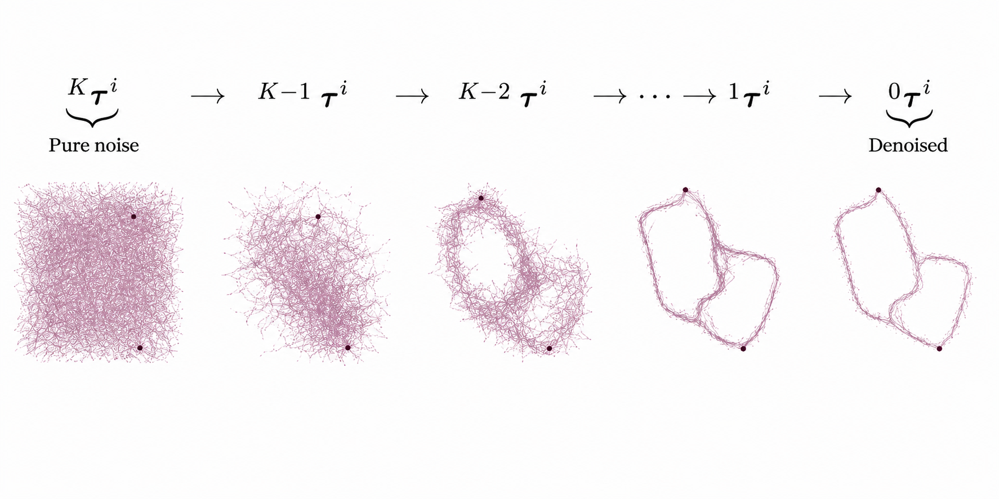
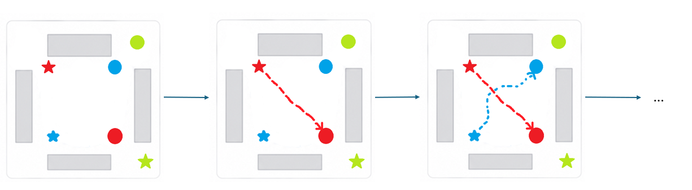
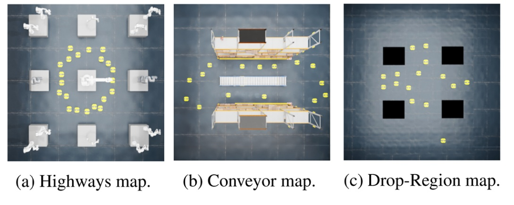
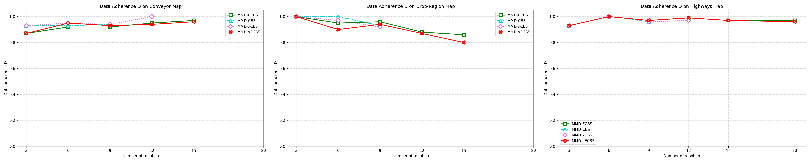
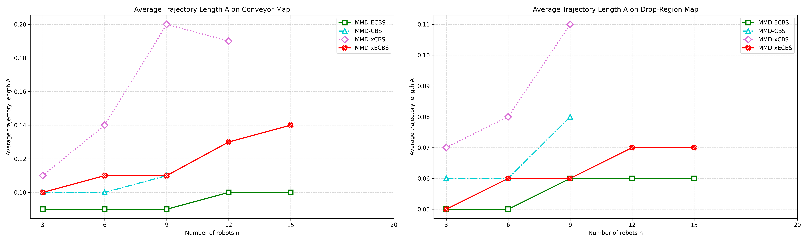
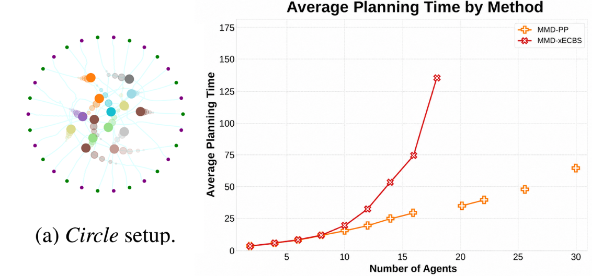
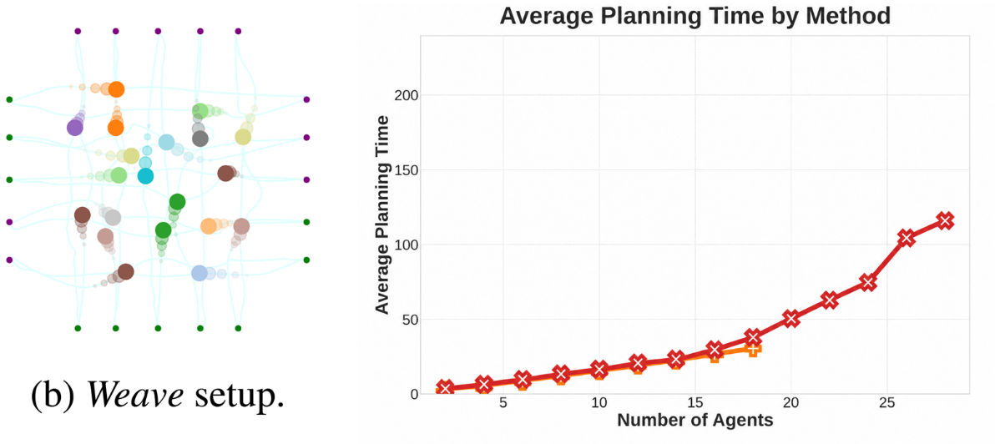

## Motivation
Imagine a busy intersection without traffic lights. Every vehicle knows where it wants to go, but without coordination, even simple movements can lead to congestion or collisions. Similar coordination problems arise in multi-robot systems, where several robots share the same space and must coordinate their movements to avoid collisions and reach their goals efficiently. This gets increasingly difficult as the number of robots grows, since every additional robot adds new interactions that the others need to account for.

This challenge is not just theoretical. As robots are increasingly deployed in applications such as warehouse automation, autonomous driving, and drone coordination, solving this coordination problem becomes critical for safety, efficiency, and scalability. Just like the intersection needs more than individual drivers acting independently, these systems need a coordination strategy that scales.

In this blog post, we explore a recent approach to this problem called Multi-robot Multi-model Planning Diffusion (MMD) <a class="citation" href="#ref-1">[1]</a>. We first introduce the multi-robot motion planning problem and outline the main categories of approaches used to address it. We then explain how MMD combines diffusion-based trajectory generation with MAPF-inspired conflict resolution and finally discuss the experimental results and their practical implications.

## Table of contents

<nav class="toc-latex toc-latex--timeline" aria-label="Table of contents">
      <ol>
        <li><a href="#motivation">Motivation</a></li>
        <li>
          <a href="#multi-robot-motion-planning">Multi-robot motion planning</a>
          <ol>
            <li><a href="#categorizing-mrmp-approaches">Categorizing MRMP approaches</a></li>
          </ol>
        </li>
        <li>
          <a href="#multi-robot-multi-model-planning-diffusion-mmd">Multi-Robot Multi-Model Planning Diffusion (MMD)</a>
          <ol>
            <li><a href="#diffusion-models">Diffusion models</a></li>
            <li><a href="#guiding-diffusion-models">Guiding diffusion models</a></li>
            <li><a href="#from-guided-trajectory-generation-to-multi-robot-planning">From Guided Trajectory Generation to Multi-Robot Planning</a></li>
            <li><a href="#mmd-pp">MMD-PP</a></li>
            <li><a href="#mmd-cbs">MMD-CBS</a></li>
            <li><a href="#mmd-ecbs">MMD-ECBS</a></li>
            <li><a href="#mmd-xcbs-and-mmd-xecbs">MMD-xCBS and MMD-xECBS</a></li>
          </ol>
        </li>
        <li><a href="#bringing-it-all-together">Bringing it all together</a></li>
        <li>
          <a href="#experiments">Experiments</a>
          <ol>
            <li><a href="#single-robot-data-vs-direct-multi-robot-learning">Single-Robot Data vs. Direct Multi-Robot Learning</a></li>
            <li><a href="#comparing-cbs-based-methods">Comparing CBS-based methods</a></li>
            <li><a href="#comparing-mmd-xecbs-to-mmd-pp">Comparing MMD-xECBS to MMD-PP</a></li>
            <li><a href="#does-it-work-in-practice">Does it work in practice?</a></li>
          </ol>
        </li>
        <li><a href="#conclusion">Conclusion</a></li>
        <li><a href="#references">References</a></li>
      </ol>
    </nav>

## Multi-robot motion planning
To design such a coordination strategy, we first need to formalize the problem. Multi-robot motion planning (MRMP) asks: given a set of robots with start and goal configurations, how can we find a collision-free trajectory for each robot over time while optimizing an objective function \\(J\\)? This objective can encode a variety of goals, such as trajectory smoothness, energy efficiency, or application-specific task objectives.

<figure class="blog-figure">
  
  <figcaption>MRMP in a weave scenario with multiple coordinated robots. Source: Shaoul et al. <a href="https://multi-robot-diffusion.github.io/" target="_blank" rel="noopener">MMD project website</a>.</figcaption>
</figure>

From a computational perspective, MRMP is highly challenging. The general, continuous version of the problem is PSPACE-hard <a class="citation" href="#ref-2">[2]</a>, and even the more restricted case where robots move along paths on a graph remains NP-complete to solve optimally for common objectives <a class="citation" href="#ref-3">[3]</a>.

## Categorizing MRMP approaches
Approaches to MRMP can be categorized by the type of planner they use <a class="citation" href="#ref-4">[4]</a>. *Search-based* motion planning uses a discrete representation of the problem and searches over it for paths; depending on the algorithm, these searches can guarantee finding a solution if one exists (completeness), an optimal solution (optimality), or both. *Sampling-based* motion planning instead avoids exploring the full configuration space and reasons over a much smaller set of randomly sampled configurations. Finally, *ML-guided* or *ML-based* approaches use learned models, either to support a conventional planner (e.g., by learning a cost map or heuristic from demonstration data) or to directly predict trajectories.

Learning behaviors directly from data has become a common approach in modern robotics more broadly. Given a large collection of example trajectories, a model can learn to generate new trajectories that exhibit similar behavior — for instance, moving the way a human operator would — without anyone having to explicitly program that behavior. The alternative, defining such motion patterns by hand, is difficult whenever a behavior is easier to demonstrate than to describe with explicit rules. While this works well for single-robot systems, extending the idea to multiple robots is challenging: as the number of robots grows, so does the complexity of their interactions, and capturing this in data requires much larger datasets. This makes collecting suitable multi-robot training data expensive and limits the scalability of many learning-based approaches.

Independently of planner type, MRMP algorithms can also be distinguished by how they handle the interaction between robots <a class="citation" href="#ref-1">[1]</a>. Decoupled algorithms plan motions for robots one after another, treating already-planned robots as moving obstacles for the rest. Coupled algorithms instead treat the problem as a single system, planning jointly over the composite configuration space of all robots. Hybrid algorithms sit in between: they split MRMP into a high level, where conflicts between robots are resolved, and a low level, where motion for each robot is planned independently — typically using single-robot planners such as A\*.

MMD fits into the category of hybrid, ML-based algorithms: it uses a high-level search to resolve conflicts (as hybrid algorithms do) and diffusion models to generate the individual trajectories (an ML-based approach). Notably, it sidesteps the data-scaling problem described above by learning exclusively from single-robot trajectory data, while still enabling collision-free planning for multiple robots.

## Multi-Robot Multi-Model Planning Diffusion (MMD)
At first glance, this way of sidestepping the data-scaling problem may seem surprising. If the model never observes interactions between multiple robots during training, how can it later generate collision-free trajectories in a multi-robot setting? To answer this question, we first need to understand the diffusion models that form the foundation of MMD.

<figure class="blog-figure">
  
  <figcaption>Figure 1: From single-robot data to coordinated multi-robot planning with MMD.</figcaption>
</figure>

### Diffusion models
Diffusion models are often used for generating images from noise. They achieve this by incrementally removing noise over many small denoising steps until a clean image is obtained. Surprisingly, teaching a model to perform many simple denoising steps is often much easier than teaching it how to generate a realistic image in a single step, as each step only has to make a small, local correction instead of solving the whole problem at once.

<figure class="blog-figure">
  
  <figcaption>Figure 2: Forward diffusion adds noise; reverse diffusion learns to remove it.</figcaption>
</figure>

But how is this relevant to our problem? We want to generate robot trajectories, not pictures of apes. Fortunately, diffusion models aren’t limited to images: applied to trajectory data, the same process instead learns to start from random noise in trajectory space and refine it into trajectories that follow the patterns of the demonstrated data. We only cover the basics here, for a more detailed introduction to diffusion models, I recommend <a class="citation" href="#ref-5">[5]</a>.

<figure class="blog-figure">
  
  <figcaption>Figure 3: The same diffusion principle applied to trajectories.</figcaption>
</figure>

Here, \\(i\\) identifies a robot, while \\(K\\) denotes the initial and noisiest step of the diffusion process. Starting from this noisy state, the trajectory for robot \\(i\\) is iteratively denoised until step \\(0\\), producing the final trajectory.

A common practice is to use stochastic rather than deterministic diffusion models, sampling the next trajectory from a normal distribution. This randomness allows the model to represent multiple plausible ways of completing the motion instead of always producing the same trajectory:

$$
{}^{k-1}\tau^i \sim \mathcal{N}\left(\mu_{k-1}^i, \beta_{k-1}\right)
$$

Here, \\(k\\) denotes the current diffusion step. The trajectory \\({}^{k-1}\tau^i\\) is sampled from a normal distribution whose mean \\(\mu_{k-1}^i\\) is predicted by the diffusion model and whose variance \\(\beta_{k-1}\\) controls how much randomness is retained during the current denoising step. Early steps typically allow more variation, while later steps make smaller refinements to the trajectory.

Generating trajectories that resemble the training data is useful, but it is not yet motion planning. A planner must also satisfy specific objectives, such as reaching a goal, avoiding obstacles, or producing smooth motion.

### Guiding diffusion models
Diffusion models let us incorporate such objectives directly into the denoising process. Instead of only following the learned data distribution, we can additionally bias each denoising step using an objective function \\(J\\).

Adding this ***guidance*** term to the formula, we obtain:

$$
{}^{k-1}\tau^i \sim \mathcal{N}\left(
\mu_{k-1}^i +
\underbrace{\eta\beta_{k-1} \nabla_{\tau} J\left(\mu_{k-1}^i\right)}_{\text{Guidance}},
\beta_{k-1}
\right)
$$

The objective function \\(J\\) can be composed of multiple sub-objectives, each targeting a different goal, with weights \\(\lambda\\) controlling how strongly each one influences the generated trajectory. For example,

$$
J
= \lambda_{\mathrm{collision}} J_{\mathrm{collision}}
+ \lambda_{\mathrm{smooth}} J_{\mathrm{smooth}}
$$

encourages trajectories that both avoid collisions and remain smooth.

One particularly useful objective is the ***sphere constraint*** — implemented as a soft constraint rather than a hard constraint — which discourages a robot from entering a predefined spherical region. Concretely, it penalizes a robot whenever its distance to a fixed point p falls below a safety radius r (see <a class="citation" href="#ref-1">[1]</a> for the exact formulation). By placing such spheres around other robots, the sphere constraint can be used to discourage collisions during trajectory generation.

Now that we can generate trajectories and steer them away from specific regions using the sphere constraint, it may seem like we have everything we need: why not simply place sphere constraints along the trajectories of all other robots and let the diffusion models do the rest?

The problem is that we still do not know ***where*** these constraints should be placed and ***when*** they should be applied. In a multi-robot scenario, collisions may occur at different locations and at different points in time. Finding an effective strategy for placing constraints therefore becomes a planning problem in its own right.

### From Guided Trajectory Generation to Multi-Robot Planning
To address this problem, MMD borrows ideas from classical Multi-Agent Path Finding (MAPF) algorithms. In MAPF, the environment is represented as a discrete graph in which robots occupy vertices, moving between adjacent vertices in discrete time steps to reach their goals without colliding with one another. Due to extensive research on MAPF, a wide range of algorithms have been developed, some of which can compute near-optimal solutions for hundreds of agents. While these algorithms were designed for MAPF's discrete setting, their conflict-resolution strategies can be transferred to the continuous trajectory-generation setting considered here. MMD adapts strategies from two well-established MAPF approaches, Prioritized Planning (PP) and Conflict-Based Search (CBS), along with several extensions of CBS. All of them offer a way to decide where and when to introduce collision-avoidance constraints during diffusion-based trajectory generation.

### MMD-PP
The simplest MMD variant, MMD-PP, adapts Prioritized Planning, which assigns a fixed priority ordering to the robots and generates their trajectories sequentially.

Figure 4 illustrates this process. First, the highest-priority robot generates its trajectory independently. In the example, the red robot plans a trajectory from its start position to its goal without considering any other robots. Once this trajectory has been generated, it is treated as a dynamic obstacle for all remaining robots.

When planning the trajectory of the blue robot, MMD places sphere constraints along the already generated red trajectory. As a result, the diffusion model of the blue robot is guided away from the red path and generates an alternative trajectory that avoids a potential collision.

<figure class="blog-figure">
  
  <figcaption>Figure 4: Prioritized planning in MMD-PP.</figcaption>
</figure>

While MMD-PP is computationally attractive because each robot only needs to be planned once, it is not guaranteed to produce collision-free solutions. Since sphere constraints are implemented as soft constraints, a lower-priority robot may still generate a trajectory that violates a constraint introduced by an earlier robot.

So far, constraints were introduced because a robot with higher priority had already claimed part of the workspace. But what if we postpone this decision until we actually observe a collision? This is exactly the idea behind MMD-CBS, the MMD variant inspired by Conflict-Based Search (CBS).

### MMD-CBS
In contrast to Prioritized Planning, MMD-CBS does not rely on an ordering of robots. Instead, it resolves collisions by searching over a ***constraint tree***, where each node represents one planning scenario: a set of collision-avoidance constraints together with the trajectories generated under these constraints.

The root node represents the initial scenario, in which all robots generate their trajectories independently, without any additional collision-avoidance constraints. If these trajectories are already collision-free, the root node is a valid solution and planning is complete.

Otherwise, MMD-CBS repeatedly expands the constraint tree using the following steps:
1. Select the leaf node with the fewest remaining collisions
2. Pick one collision and split the node into two child nodes, each constraining a different one of the two colliding robots.
3. In each child node, recompute the trajectory of the newly constrained robot under this additional constraint.

Figure 5 illustrates this process for a single collision between the red and blue robot. We start at the root node in Figure 5(a), the only node available at this point, where the two trajectories collide. Since this node contains only one collision, we pick that collision to resolve next. This creates the two child nodes shown in Figure 5(b): the left one constrains the blue robot at the conflict location and time, while the right one constrains the red robot instead. In each child node, only the newly constrained robot replans its trajectory, guided away from the collision by the added constraint, while the other robot's trajectory remains unchanged, as shown in Figure 5(c). Since replanning can introduce new collisions elsewhere, this process is repeated, expanding the tree further until a node with no remaining collisions is found.

<figure class="blog-figure">
  
  <figcaption>Figure 5: Conflict-Based Search resolves a collision by branching over constraints.</figcaption>
</figure>

Compared to MMD-PP, MMD-CBS introduces constraints only when they are actually needed. Instead of committing to a fixed priority ordering, it repeatedly analyzes the generated trajectories and resolves detected conflicts. This makes the method more robust than MMD-PP and allows it to find collision-free solutions in cases where a fixed priority ordering may fail.

The downside is that MMD-CBS must maintain and explore the constraint tree, which grows more expensive as the number of robots and conflicts increases. To improve efficiency, the authors propose several extensions, the first of which is MMD-ECBS.

### MMD-ECBS
In addition to the conflict-specific constraints used by MMD-CBS, MMD-ECBS introduces a second type of constraint. These additional soft constraints encourage robots to stay away from the trajectories of other robots, even if no collision has been detected yet. As a result, newly generated trajectories are not only guided away from previously observed conflict locations but are also biased away from potentially problematic regions of the workspace.

To distinguish between the two types of constraints, the collision-resolving constraints are referred to as ***strong constraints***, while the trajectory-avoidance constraints are called ***weak constraints***. Since avoiding a confirmed collision is more important than merely discouraging robots from getting close to one another, the weak constraints are assigned a smaller weight in the objective function.

### MMD-xCBS and MMD-xECBS
While MMD-ECBS improves the quality of generated trajectories, the diffusion model still generates a completely new trajectory whenever replanning is required. The final extensions, MMD-xCBS and MMD-xECBS, address exactly this inefficiency.

Instead of restarting the diffusion process from pure random noise, these methods reuse the previously generated trajectory. To do so, they add noise for only a small number of diffusion steps and then continue the denoising process under the newly introduced constraints. Since the previous trajectory is already close to a feasible solution, this approach requires significantly less computation than generating an entirely new trajectory from scratch.

## Bringing it all together
Stepping back, the central idea behind MMD is surprisingly simple. Instead of learning complex interactions between multiple robots directly from data, MMD learns only how individual robots should move, using only single-robot trajectory data. Whenever conflicts between robots arise, MAPF-inspired planning strategies determine where additional constraints should be introduced. The diffusion models then generate trajectories that simultaneously respect these constraints and remain faithful to the demonstrated motion patterns. In this way, MMD combines the strengths of learning-based trajectory generation and search-based conflict resolution.

## Experiments
To evaluate whether MMD actually works, the authors run a broad set of experiments. In this post, we focus on three of them: whether learning from single-robot data is sufficient compared to learning multi-robot coordination directly, which of MMD's CBS-based planning strategies performs best, and how the strongest of these variants compares to the simpler MMD-PP approach across different environments.

Three metrics appear repeatedly across these experiments: data adherence, trajectory length, and planning time. **Data adherence** measures how closely a generated trajectory matches the motion patterns seen in the training data. This matters because the whole appeal of learning from data, rather than hand-defining motion patterns, is that the model captures realistic behavior on its own. High data adherence confirms that this works, rather than just checking whether a trajectory happens to avoid collisions. **Trajectory length** measures how far a robot travels to reach its goal. Shorter trajectories are generally preferable, since they suggest fewer unnecessary detours and more efficient motion. Finally, **planning time** captures the computational cost of generating a solution.

### Single-Robot Data vs. Direct Multi-Robot Learning
One of the central ideas behind MMD is that it learns only from single-robot data relying on a classical planner to handle multi-robot coordination rather than learning it directly.

To evaluate whether this design choice is effective, the authors compare MMD-xECBS to MPD-Composite, a diffusion model trained to generate multi-robot trajectories directly.

As shown in Figure 6, both approaches perform well for small robot teams. However, the performance of MPD-Composite rapidly deteriorates as the number of robots increases, eventually failing to generate valid solutions. MMD-xECBS, on the other hand, maintains a high level of data adherence and continues to generate collision-free trajectories even for substantially larger robot teams. These results suggest that learning multi-robot coordination directly is difficult, and that MMD's strategy of offloading coordination to a classical planner instead is the more effective approach in these experiments.

<figure class="blog-figure">
  
  <figcaption>Figure 6: Single-robot data with MMD-xECBS compared to direct multi-robot learning.</figcaption>
</figure>

A closer look: There is a caveat to this comparison that is worth unpacking. MPD-Composite was not trained on real multi-robot demonstrations, since these are expensive to collect, but on multi-robot datasets assembled from collision-free single-robot trajectories generated independently rather than planned together. An initial reading of the main results may suggest that diffusion models are fundamentally unable to handle multi-robot complexity. However, a more careful analysis, including the discussion the authors provide in the appendix, points to a more specific explanation: learning from this kind of composed data is difficult, which is a narrower claim than it might first appear.

### Comparing CBS-based methods
Beyond the choice to learn from single-robot data, MMD offers several planning strategies for resolving conflicts. We first look at which CBS-based variant performs best across three different environments.

<figure class="blog-figure">
  
  <figcaption>Figure 7: Evaluation maps used in the CBS-based method comparison.</figcaption>
</figure>

In terms of data adherence (Figure 8), there is little difference between the algorithms: all of them consistently score above 0.8, showing that they generate data-adherent trajectories regardless of the conflict-resolution strategy used.

<figure class="blog-figure blog-figure--data">
  

    
    
    
  

  <figcaption>Figure 8: Average data adherence by method.</figcaption>
</figure>

The success rate (Figure 9) is more revealing, especially since the pattern holds consistently across all three maps. MMD-CBS performs worst and starts to struggle once the number of robots reaches 9, while MMD-xCBS is only marginally better. MMD-ECBS clearly outperforms both, but is itself outperformed by MMD-xECBS. As the strongest method overall, MMD-xECBS still generates valid trajectories for up to 15 robots on the Conveyor and Drop-Region maps, and even up to 20 on the Highways map.

<figure class="blog-figure blog-figure--data">
  

    
    
    
  

  <figcaption>Figure 9: Success rate by method across maps.</figcaption>
</figure>

This ranking is also reflected in the planning time (Figure 10). While the xCBS extension adds little in terms of effectiveness, MMD-ECBS substantially reduces planning time compared to MMD-CBS. Since planning time is one of the key bottlenecks for scaling MMD to larger robot teams, this improvement is particularly relevant in practice.

<figure class="blog-figure blog-figure--data">
  

    
    
    
  

  <figcaption>Figure 10: Average planning time by method.</figcaption>
</figure>

The average trajectory length on the Conveyor and Drop-Region maps adds an interesting nuance (Figure 11): MMD-xCBS produces trajectories that are almost twice as long as those of MMD-ECBS. So while ECBS improves trajectory length compared to plain CBS, adding the reuse mechanism in xCBS makes it worse again. The same reuse mechanism is also used in MMD-xECBS, but there it starts from ECBS's much lower baseline, so even with some of that length increase reintroduced, MMD-xECBS still ends up shorter than plain CBS or xCBS. One possible explanation is that reusing a previous trajectory instead of fully regenerating it from noise inherently costs some optimality, and ECBS's constraint structure only partially offsets that cost.

<figure class="blog-figure blog-figure--data blog-figure--data-two-panels">
  

    
    
  

  <figcaption>Figure 11: Average trajectory length by method on the Conveyor and Drop-Region maps. The Highways map is excluded because it does not show a clear pattern.</figcaption>
</figure>

Taken together, MMD-xECBS appears to be the most effective method across these scenarios. Whether this generalizes to other settings remains an open question. And while its trajectories are somewhat longer than those of MMD-ECBS, I think the efficiency gain is worth the trade-off: since scalability remains MMD's biggest limitation, a slightly suboptimal solution is still preferable to none at all.

### Comparing MMD-xECBS to MMD-PP
Now that we know MMD-xECBS performs best among the CBS-based variants, let's look at two comparisons between MMD-xECBS and MMD-PP across different scenarios.

In the Circle setup (Figure 12), the planning time of MMD-xECBS grows much more steeply than that of MMD-PP, which increases at a noticeably flatter rate. Because of this, MMD-xECBS is unable to generate valid trajectories for more than about 18 robots, while MMD-PP still succeeds for up to 30. However, MMD-PP does not reliably find valid solutions at every robot count: for some numbers of robots it succeeds, while for others, including some smaller ones, it fails. Its wider scaling range therefore comes at the cost of consistency.

<figure class="blog-figure">
  
  <figcaption>Figure 12: Circle setup and planning time comparison.</figcaption>
</figure>

The Weave setup (Figure 13) tells a different story: here, the planning times of both methods are very similar up to around 18 robots, at which point MMD-PP stops producing valid solutions altogether, while MMD-xECBS continues to scale up to around 28 robots.

<figure class="blog-figure">
  
  <figcaption>Figure 13: Weave setup and planning time comparison.</figcaption>
</figure>

Taken together, these two comparisons show that neither method is consistently better: which algorithm performs best depends heavily on the structure of the environment. This is a practical limitation, since it means, one would need to know something about the environment in advance to choose the right algorithm.

### Does it work in practice?

Having looked at all these experiments, let's answer the question of whether MMD is usable in practice.

My take: yes, *but*, with heavy emphasis on the "but".

The experiments clearly show that MMD scales to multiple robots while remaining data adherent. Across everything we covered, the strongest MMD variants reliably generated valid trajectories for at least 15 robots. The question is how far that gets us in practice. In a fully automated warehouse, for instance, operations are unlikely to stop at 15 robots; realistic deployments would need to handle numbers closer to the hundreds or thousands. 

Planning time is another concern. Looking at Figures 12 and 13, planning times in the range of 30 seconds are not unusual and would likely be too slow for applications that require frequent real-time replanning.

On top of that, as evaluated in the paper, MMD is mostly a pre-planning method: it plans trajectories up front and then has the robots execute them, without reacting to changes in the environment as they happen. In a setting with dynamic elements, humans walking through the workspace, for example, this is a significant limitation. Robots need to be able to react to unexpected changes in real time, not just follow a plan computed in advance.

That said, these limitations point to directions for future work rather than dead ends. Faster planning strategies or mechanisms for reacting to a changing environment could, in principle, be integrated into MMD's framework without giving up its core advantage of learning from single-robot data alone.

## Conclusion
MMD addresses one of the central challenges in multi-robot motion planning: how can multiple robots be coordinated without requiring large amounts of multi-robot training data? Its key idea is to combine diffusion-based trajectory generation with search-based conflict resolution. Instead of learning multi-robot interactions directly, MMD trains diffusion models on single-robot trajectories and then uses MAPF-inspired planning strategies to introduce constraints whenever conflicts between robots occur. The experiments show that this idea is promising. In the evaluated scenarios, the stronger MMD variants often generate valid trajectories for around 15 robots or more while preserving the motion patterns learned by the diffusion models. This is especially interesting because it suggests that multi-robot behavior does not necessarily have to be learned from multi-robot demonstrations directly.

At the same time, important limitations remain: planning time, scalability, dependence on environment structure. The fact that the best-performing variant differs across scenarios further complicates practical use. Taken together, these limitations mean MMD is less a ready-to-use warehouse planner and more a promising research direction — its main contribution is showing that single-robot diffusion models can be reused for multi-robot planning without collecting expensive multi-robot datasets.

I think the future of this line of work lies less in scaling up the diffusion models themselves, and more in making the coordination layer faster and more reactive. This also connects to the authors’ own future-work discussion, where they point to more flexible planning horizons, faster CBS-based search, and more collaborative robot tasks as possible next steps. For practical use, the key question is whether the system can move toward online replanning instead of relying only on trajectories computed upfront. If future work can move in that direction, MMD could become a valuable step toward more practical learning-based robot coordination.

## References

<ol class="references-latex">
  <li id="ref-1">I. M. S. V. J. L. M. L. Yorai Shaoul, "MULTI-ROBOT MOTION PLANNING WITH DIFFUSION," in ICLR, 2025.</li>
  <li id="ref-2">G. T. W. John E. Hopcroft, "Reducing multiple object motion planning to graph searching," SIAM Journal on Computing, vol. 15, no. 3, pp. 768-785, 1986.</li>
  <li id="ref-3">S. M. L. Jingjin Yu, "Intractability of Optimal Multi-Robot Path Planning on Planar Graphs," IEEE Robotics and Automation Letters, vol. 1, no. 1, pp. 33-40, 2016.</li>
  <li id="ref-4">H.-D. Bui, "A Survey of Multi-Robot Motion Planning," Fairfax, Virginia, 2023.</li>
  <li id="ref-5">D. Bergmann and C. Stryker, "What are Diffusion Models?," 2024.</li>
  <li id="ref-6">R. S. e. al., "Multi-Agent Pathfinding: Definitions, Variants, and Benchmarks," 2019.</li>
</ol>
